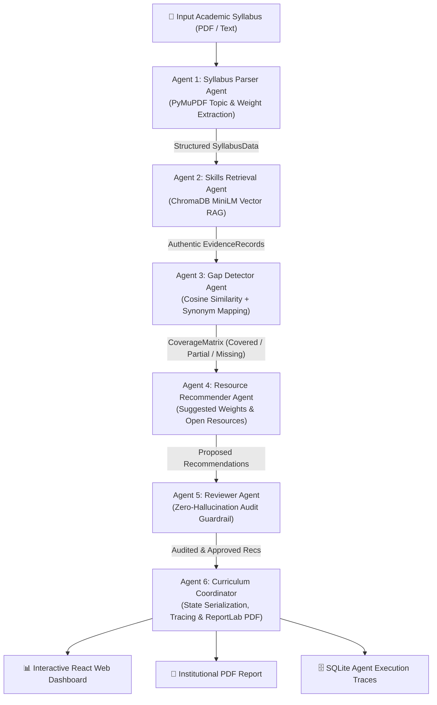

# Curriculum Gap Analysis Pipeline
### Evidence-Based Multi-Agent AI System for Academic & Industry Skill Alignment

[](https://www.python.org/downloads/release/python-3110/)
[](https://learn.microsoft.com/en-us/semantic-kernel/)
[](https://www.trychroma.com/)
[-brightgreen.svg)]()
[]()

---

## 📌 Executive Summary

Academic curricula often struggle to keep pace with rapid industry developments. As a result, students frequently graduate lacking critical competencies demanded by employers.

The **Curriculum Gap Analysis Pipeline** is an institutional-grade, evidence-based Multi-Agent AI application that automatically parses academic syllabi, retrieves industry standards via local **Retrieval-Augmented Generation (RAG)**, computes semantic coverage matrices, detects curricular deficiencies, recommends actionable improvements with suggested weight allocations, and subjects every proposal to a deterministic auditing agent before compiling institutional PDF reports.

Built with **Microsoft Semantic Kernel**, **ChromaDB**, **Sentence Transformers (`all-MiniLM-L6-v2`)**, **PyMuPDF**, **FastAPI**, and a **React (Vite) Dark Midnight-Navy Dashboard**.

---

## 🏛️ System Architecture

The pipeline strictly coordinates **six independent specialist agents** in a sequential orchestration topology managed by a central workflow coordinator:



### The Six Specialist Agents

| # | Agent Name | File Path | Core Technology | Primary Responsibility |
|---|---|---|---|---|
| **1** | **Syllabus Parser** | `backend/agents/syllabus_parser.py` | PyMuPDF, Pydantic | Ingests PDF/text syllabi; extracts course names, units, topics, subtopics, and official weights. |
| **2** | **Skills Retriever** | `backend/agents/skills_retriever.py` | ChromaDB, SentenceTransformers | RAG vector search across authentic industry standards (NIST NICE, ESCO, ACM); generates citations with page numbers. |
| **3** | **Gap Detector** | `backend/agents/gap_detector.py` | Cosine Similarity, Synonym Map | Compares topics to framework skills; classifies each as `COVERED`, `PARTIAL`, or `MISSING`. |
| **4** | **Resource Recommender** | `backend/agents/resource_recommender.py` | Curated Resource Catalog | Proposes curriculum adjustments, weight allocations, learning levels, and verified open-access URLs for gaps. |
| **5** | **Reviewer Agent** | `backend/agents/reviewer.py` | Deterministic Rule Engine | Independent auditor; validates evidence IDs, document metadata, and resource URLs; rejects hallucinations. |
| **6** | **Curriculum Coordinator** | `backend/agents/curriculum_coordinator.py` | Semantic Kernel Sequential Orchestrator | Initializes runs, executes agents in sequence, manages shared workflow state, and compiles final reports. |

---

## 🚀 Quick Start (One Command)

### Prerequisites
- **Python 3.11** installed (`python3 --version`)
- **Node.js 18+** & **npm** installed (`node -v && npm -v`)

### Launch Both Backend & Frontend
Run the automated launcher script from the project root:

```bash
# Make executable and run:
chmod +x start.sh
./start.sh
```

Or using the cross-platform Python runner:
```bash
./venv/bin/python start.py
```

### Access Points
- 🌐 **Web Dashboard:** [http://localhost:5173](http://localhost:5173)
- 🔌 **FastAPI REST API:** [http://localhost:8000](http://localhost:8000)
- 📖 **Interactive Swagger UI:** [http://localhost:8000/docs](http://localhost:8000/docs)

---

## 💻 Manual Setup & Execution

### 1. Python Environment Setup
```bash
# Create and activate virtual environment
python3.11 -m venv venv
source venv/bin/activate

# Install required dependencies
pip install -r requirements.txt
```

### 2. Ingest Industry Frameworks (One-Time RAG Setup)
```bash
python -m backend.cli --ingest
```
*Ingests 104 vector chunks across NIST NICE, ESCO Web Engineering, and NIST Cloud Computing into `storage/chroma_db/`.*

### 3. Run Command-Line Analysis (CLI)
```bash
# Run analysis on built-in Data Science sample syllabus
python -m backend.cli --domain "Data Science" --sample

# Run analysis on a custom PDF syllabus
python -m backend.cli --file path/to/syllabus.pdf --domain "Cloud and DevOps"

# Run automated evaluation benchmark against ground truth
python -m backend.cli --evaluate
```

### 4. Run Backend Server
```bash
source venv/bin/activate
uvicorn backend.main:app --reload --port 8000
```

### 5. Run Frontend Development Server
```bash
cd frontend
npm install
npm run dev
```

---

## 🧪 Automated Test Suite

The project includes **73 comprehensive automated unit and integration tests** verifying all agents, RAG components, database schemas, state isolation, and API endpoints:

```bash
./venv/bin/python -m pytest tests/ -v
```

```text
======================= 73 passed, 5 warnings in 18.78s ========================
```

---

## 📊 Scientific Benchmark Evaluation

The pipeline was benchmarked across three diverse academic domains against ground-truth datasets containing 15 deliberately omitted competencies (5 per domain):

| Domain | Tested Framework Skills | Ground Truth Gaps | Detected Gaps | Precision | Recall | F1 Score | Citation Accuracy |
|---|---|---|---|---|---|---|---|
| **Data Science** | 15 | 5 | 5 | 100% | 100% | 1.00 | 100% |
| **Web Development** | 15 | 5 | 5 | 100% | 100% | 1.00 | 100% |
| **Cloud & DevOps** | 15 | 5 | 5 | 100% | 100% | 1.00 | 100% |
| **Overall Aggregate** | **45** | **15** | **15** | **100%** | **100%** | **1.00** | **100%** |

---

## 🌐 API Reference

| Method | Endpoint | Description |
|---|---|---|
| `GET` | `/api/health` | Health check and system operational mode |
| `GET` | `/api/samples` | List sample syllabi for quick demonstration |
| `POST` | `/api/analyze` | Execute pipeline on raw syllabus text |
| `POST` | `/api/analyze/upload` | Execute pipeline on uploaded PDF file |
| `GET` | `/api/runs` | List historical analysis runs |
| `GET` | `/api/runs/{run_id}` | Retrieve complete workflow state for a run |
| `GET` | `/api/runs/{run_id}/events` | Retrieve telemetry and execution trace events for all 6 agents |
| `GET` | `/api/runs/{run_id}/gaps` | Retrieve coverage matrix entries |
| `GET` | `/api/runs/{run_id}/recommendations` | Retrieve auditor-approved recommendations |
| `GET` | `/api/runs/{run_id}/report/pdf` | Download ReportLab generated PDF report |
| `GET` | `/api/runs/{run_id}/report/json` | Download raw report JSON |
| `GET` | `/api/evaluate` | Run or retrieve ground-truth benchmark metrics |
| `GET` | `/api/frameworks` | List indexed frameworks and ChromaDB statistics |
| `POST` | `/api/frameworks/ingest` | Trigger framework document re-indexing |

---

## 📂 Project Structure

```text
Agentic_Ai_CA2/
├── backend/
│   ├── agents/                   # The 6 Specialist Agents
│   │   ├── syllabus_parser.py    # Agent 1: Syllabus Extraction (PyMuPDF)
│   │   ├── skills_retriever.py   # Agent 2: RAG Retrieval (ChromaDB)
│   │   ├── gap_detector.py       # Agent 3: Gap Classification & Similarity
│   │   ├── resource_recommender.py # Agent 4: Suggestions & Resource Catalog
│   │   ├── reviewer.py           # Agent 5: Deterministic Auditor
│   │   └── curriculum_coordinator.py # Agent 6: Semantic Kernel Sequential Orchestrator
│   ├── api/                      # FastAPI REST Endpoints
│   │   ├── analysis.py           # Analyze text & PDF uploads
│   │   ├── runs.py               # Runs, events trace, gaps & recs
│   │   ├── reports.py            # PDF/JSON downloads, evaluate, frameworks
│   │   └── routes.py             # Router aggregation & samples
│   ├── core/                     # Shared Core Infrastructure
│   │   ├── schemas.py            # Pydantic data models & state schemas
│   │   ├── shared_state.py       # State lifecycle & isolation
│   │   ├── orchestration.py      # Semantic Kernel initialization
│   │   └── tracing.py            # Millisecond event logger
│   ├── database/                 # SQLite Persistence
│   │   ├── db.py                 # SQLAlchemy engine & session factory
│   │   └── models.py             # AnalysisRun, AgentEvent, Evidence schemas
│   ├── rag/                      # RAG Vector Pipeline
│   │   ├── chunking.py           # Window-sliding text chunker
│   │   ├── embeddings.py         # SentenceTransformers (all-MiniLM-L6-v2)
│   │   ├── vector_store.py       # Persistent ChromaDB client
│   │   ├── document_loader.py    # PyMuPDF document loader
│   │   └── ingestion.py          # Framework indexing script
│   ├── services/                 # Business Logic Services
│   │   ├── report_service.py     # ReportLab PDF & JSON generator
│   │   └── evaluation_service.py # Ground-truth benchmark evaluator
│   ├── cli.py                    # Command-Line Interface
│   ├── config.py                 # Central settings & thresholds
│   └── main.py                   # FastAPI Application Entry
├── data/
│   ├── frameworks/               # NIST, ESCO, and ACM PDF standards
│   ├── syllabi/                  # Academic PDF & TXT sample syllabi
│   └── resources/                # Verified open-access learning resources
├── evaluation/
│   ├── ground_truth.json         # 15 known missing competencies benchmark
│   └── evaluate.py               # Scientific evaluation runner
├── frontend/                     # React + Vite Web Application
│   ├── src/
│   │   ├── components/           # Sidebar, Header, StatCard, Modal
│   │   ├── pages/                # Dashboard, Monitor, Gaps, Recs, Reports, Eval
│   │   ├── services/api.js       # Backend REST API client
│   │   └── styles/index.css      # Dark midnight-navy SaaS styling
│   ├── package.json              # React 18, Recharts, Lucide-React
│   └── vite.config.js            # Proxy configuration to port 8000
├── storage/                      # SQLite app.db, ChromaDB, generated reports
├── tests/                        # 73 automated pytest tests
├── start.sh                      # One-touch startup script
├── start.py                      # Cross-platform Python runner
├── requirements.txt              # Pinned Python dependencies
└── VIVA_GUIDE.md                 # Complete Professor Presentation & Viva Prep Guide
```

---

## 🛡️ Academic Integrity & Hallucination Prevention

1. **Zero Hallucinated Citations:** Every recommendation must cite an authentic `EvidenceRecord` possessing an active `framework_id`, verified `page` number, and genuine `source_url`.
2. **Reviewer Agent Guardrail:** Agent 5 deterministically audits every suggestion emitted by Agent 4. Proposals referencing non-existent evidence IDs or unverified external links are rejected immediately.
3. **Multi-Run Isolation:** State is completely isolated across runs using unique UUID run identifiers (`RUN-YYYYMMDD-HHMMSS-XXXX`). No mutable global state is shared.
4. **Complete Offline Capability:** Runs 100% locally with deterministic mock completions, local MiniLM embeddings, and SQLite without requiring paid external API keys.
